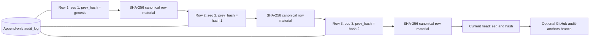

# Architecture

## Request and decision path

```mermaid
flowchart LR
  Agent[Agent SDK or demo agent] -->|POST tool call, bearer key| API[Express API]
  Browser[Dashboard browser] -->|Same-origin /api requests| Next[Next.js dashboard and rewrite]
  Next --> API
  API --> Auth[Authenticate and validate]
  Auth --> Store[Persist call and call_received audit event]
  Store --> Score[Rule scorer plus injection classifier]
  Score --> PolicyInput[Build policy input and load agent limits]
  PolicyInput --> OPA[OPA Rego policy]
  OPA --> Decide{allow, approve, block}
  Decide -->|allow| Mock[Sandboxed mock tool]
  Decide -->|approve| Approval[Pending approval workflow]
  Approval -->|approved| Mock
  Approval -->|rejected or timeout| Deny[Do not execute]
  Decide -->|block| Deny
  Mock --> Audit[Append result to hash-chained audit log]
  Deny --> Audit
  Approval --> Audit
  Audit --> DB[(PostgreSQL)]
  DB --> Feed[LISTEN/NOTIFY change feed]
  Feed -->|SSE| Next
  Next -->|Polling fallback| API
```

1. **HTTP and authentication:** `apps/api/src/http/routes.ts` validates requests and authenticates agent/admin routes through `apps/api/src/auth/auth.ts`.
2. **Interception and scoring:** `apps/api/src/interceptor/pipeline.ts` records receipt, loads recent-call and per-agent policy context, calls `apps/api/src/scoring/riskScoring.ts`, and persists score details. `ruleScorer.ts` handles checklist factors, `sqlAnalysis.ts` tokenizes SQL for risk classification, `sensitiveData.ts` classifies sensitive email content, and `injectionClassifier.ts` scores free text.
3. **Policy:** `apps/api/src/policy/policyClient.ts` constructs the Rego input and calls OPA. The policy decision remains authoritative in `policies/agentguard.rego`; API failures fail closed.
4. **Action and approval:** `apps/api/src/approvals/approvals.ts` resolves review requests atomically and sweeps expired requests. `apps/api/src/tools/mockTools.ts` is the only executor in this repository; its tools are mocks.
5. **Audit:** each transition appends a row using `apps/api/src/audit/auditLog.ts` and the hash primitives in `apps/api/src/audit/hashChain.ts`.
6. **Dashboard updates:** `apps/api/src/realtime/changeFeed.ts` relays database notifications over SSE. `apps/dashboard/lib/live.tsx` falls back to polling when the connection fails or stops delivering heartbeats.
7. **Independent checks:** `/metrics` is implemented by `apps/api/src/metrics.ts` and `apps/api/src/app.ts`; optional Sentry scrubbing is in `apps/api/src/sentry.ts`; anchor publication and checking are in `.github/workflows/anchor.yml` and `apps/api/src/audit/anchors.ts`.

## Audit hash chain

For row `n`, `computeHash` hashes canonical JSON containing `seq`, `event_type`, `payload`, `created_at`, and `prev_hash` (`GENESIS_PREV_HASH` for the first row) in `apps/api/src/audit/hashChain.ts`. `appendAudit` takes a PostgreSQL advisory transaction lock, reads the previous row, computes the next link, and inserts it (`apps/api/src/audit/auditLog.ts`). A trigger rejects updates/deletes and the application database role has no such grants (`db/migrations/001_initial_schema.sql`, `apps/api/src/db/migrate.ts`).

`verifyAuditLog` recomputes the chain; with `--anchors`, it also requires every published sequence/hash pair to remain present and unchanged. The automation reads only `{seq, hash}` and appends timestamped JSON lines to the separate `audit-anchors` branch. Anchors protect only through the latest publication and rely on the anchor repository being controlled separately from the database.
